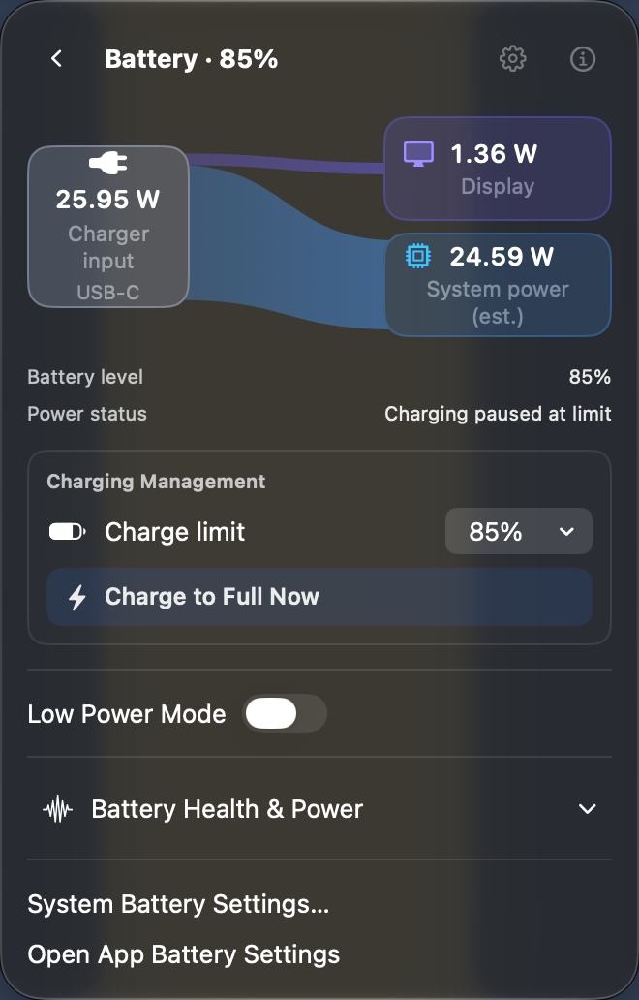
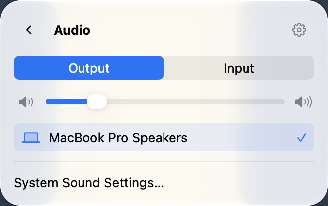

# TrioRing

**电量、网络、声音，一个菜单栏图标。**

我做 TrioRing，是想少开几次「系统设置」。插着电的时候，抬眼就知道 Mac 是在充电，还是已经停在我设的上限。耳机接上了，点一下就能看现在从哪儿出声。要看细节，再往里点一层。

 

- **电池** · 充电暂停和 macOS 校准会明写。支持的 Mac 能看功率流、电池健康和 USB‑C 端口功耗，也能调整充电上限或临时充满。
- **网络** · 看当前 Wi‑Fi、IP、VPN 和系统代理。授权定位后可以扫描附近网络，从紧凑列表里选；企业网络交给 macOS 设置。
- **声音** · 首页就能调音量、静音和切输出。支持的 AirPods 还能看分耳和充电盒电量，点图标切换降噪、通透或自适应。

首页和详情共用系统 Liquid Glass，跟随 macOS 深浅色和「减少透明度」。菜单栏图标和状态面板都可以自己排。点击菜单栏图标就能开始，`⌘,` 打开设置。

## 在 Mac 上试试

需要 Apple Silicon Mac 和 macOS 26 或更新版本。界面提供简体中文和英文。

**[下载 TrioRing 0.7.38（DMG）](https://github.com/williamhsu218/TrioRing/releases/download/v0.7.38/TrioRing-0.7.38-arm64.dmg)**

这个预览包用 **Apple Development** 签名，**未经过 Apple 公证**。打开 DMG 后，把 TrioRing 拖进「应用程序」。macOS 可能会阻止首次启动。

从 0.7.35 开始，右键菜单栏图标，或在面板底部点「…」，选择「检查更新…」。Sparkle 会从 GitHub 下载并验证更新，确认后安装。0.7.34 和更早版本需要先手动装一次。

想让 TrioRing 主动提醒，可以在「设置 → 通用 → 更新」打开「自动检查更新」。开关默认关闭。开启后，Sparkle 会定期检查 GitHub，发现新版时菜单栏图标会亮起蓝点。安装仍由你确认。

### 从源码构建

需要带有 macOS 26 或更新 SDK 的 Xcode 工具链。

```bash
git clone https://github.com/williamhsu218/TrioRing.git
cd TrioRing
./script/build_and_run.sh
```

脚本会构建并打开 `dist/TrioRing.app`。想放到「应用程序」里，可以运行 `./script/install.sh`。第一次启动后，到菜单栏找 TrioRing。

- 附近 Wi‑Fi 扫描需要定位授权。切换电量模式需要在 macOS 批准一次后台助手，助手还需要与 App 一起签名。
- 功耗读数、充电控制和 AirPods 聆听模式取决于硬件与系统版本。TrioRing 检测到 AlDente 正在运行时会暂停写入充电设置。

[查看 0.7.38 版本](https://github.com/williamhsu218/TrioRing/releases/tag/v0.7.38) · [版本记录](https://github.com/williamhsu218/TrioRing/releases)

## 开发

用 SwiftUI 做面板和设置，用 AppKit 管菜单栏、窗口定位和材质。应用内更新使用 Sparkle 2。

```bash
swift test
TRIORING_RENDER_UI=1 swift test --filter PanelUXRenderTests
```

### 发布更新

用与上一版相同的 Apple 签名身份构建 App，再运行 `./script/package.sh`。DMG 上传到对应版本的 GitHub Release 后，生成并提交更新源。

```bash
./script/make_appcast.sh /path/to/Sparkle/bin dist/TrioRing-0.7.38-arm64.dmg > dist/appcast.xml \
  && mv dist/appcast.xml updates/appcast.xml
```

脚本用钥匙串里账号为 `com.willhsu.ring-a-bar` 的 Sparkle 密钥签名。仓库只保存公钥、签名和更新源。

## 许可

第三方代码的许可和署名随源码提供。TrioRing 新增代码目前未声明统一的再分发许可。 [第三方许可与署名](Resources/ThirdParty)
